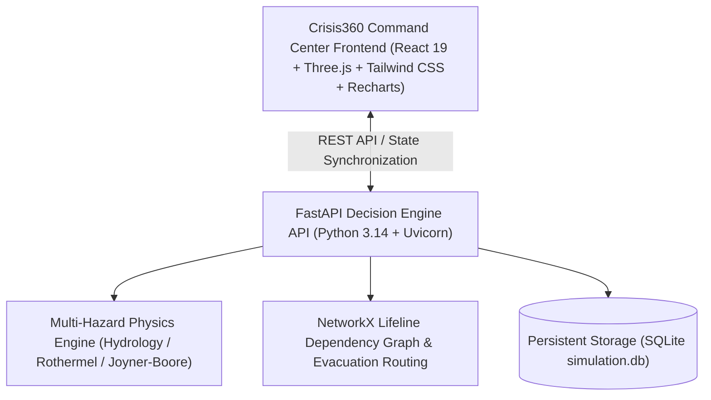

# Crisis360 — Intelligent Disaster Simulation & Response Platform

> **Multi-Hazard Predictive Decision Engine & 3D Digital Twin Platform for Indian Metropolitan Cities**

Crisis360 is an emergency operations platform and interactive 3D digital twin system engineered for disaster mitigation, predictive risk modeling, and multi-branch decision analysis. It simulates hazardous events across Indian metropolitan regions (Hyderabad, Chennai, Mumbai, Bengaluru, Delhi, Visakhapatnam) and forks scenarios from identical initial conditions into three independent future branches to evaluate intervention strategies in real time.

---

## 1. System Architecture



### Technology Stack
- **Frontend**: React 19, TypeScript, Three.js (WebGL), Tailwind CSS, Recharts, Lucide Icons, Vite.
- **Backend**: Python 3.14, FastAPI, Pydantic v2, NetworkX, NumPy, SciPy, Uvicorn, SQLite.
- **Client Fallback**: Integrated client-side simulation engine ensures 100% operational readiness in offline or air-gapped emergency environments.

---

## 2. Indian Metropolitan Digital Twins

Crisis360 features procedural 3D digital twins representing six major Indian metropolitan areas:

| City | State | Waterways & Geography | Primary Disaster Hazards | Named Critical Lifelines |
|---|---|---|---|---|
| **Hyderabad** | Telangana | Musi River basin, Hussain Sagar | Flash Floods, Urban Inundation | Osmania General Hospital, HITEC City Substation, Asif Nagar Water Works |
| **Chennai** | Tamil Nadu | Bay of Bengal coast, Cooum & Adyar rivers | Cyclone Storm Surges, Coastal Floods | Rajiv Gandhi Govt General Hospital (RGGGH), Tidel Park Substation, Kilpauk Water Works |
| **Mumbai** | Maharashtra | Arabian Sea coast, Mithi River | Monsoon Deluges, Coastal Surges | KEM Hospital & Trauma Center, Dharavi Grid Substation, Bhandup Complex |
| **Bengaluru** | Karnataka | Bellandur & Varthur lake cascades | Urban Drainage Surcharges | Victoria Hospital Trauma Block, HAL Power Grid Station, CWSS Stage IV Plant |
| **Delhi** | NCT Delhi | Yamuna River Khadar plains | River Overtopping, Urban Interface Fires | AIIMS Trauma Center, Indraprastha Power Substation, Wazirabad Water Works |
| **Visakhapatnam** | Andhra Pradesh | Bay of Bengal, Eastern Ghats foothills | Cyclone Landfall Surges, Industrial Fires | King George Hospital (KGH), Simhachalam Grid Station, Meghadrigedda Water Plant |

---

## 3. Disaster Simulation Solvers & Visible Destruction

### A. Real Source-Based Hydrological Flood Solver
- **Origins**: Musi River catchment overtopping, Dam breach / reservoir sluice discharge, Urban storm drainage surcharge, Industrial pipeline rupture, and Coastal storm surge.
- **Visible 3D Source Marker**: Real-time 3D beacon pin indicating hazard origin coordinates in the scene.
- **Propagation**: Topographical elevation-aware cellular spreading, dynamic water table rise, color-coded depth contour rings, road submergence, bridge clearance impassability, and structural saturation damage.

### B. Rothermel Wildfire & Urban Interface
- **Wind Vector & Azimuth**: Propagates according to local wind velocity and direction.
- **Fuel & Humidity**: Modulated by vegetation density, humidity percentages, and structural fuel loads.
- **Effects**: Dynamic smoke mesh generation, structural charring, and firebreak containment.

### C. Joyner-Boore Seismic Fault Rupture
- **Attenuation**: Peak Ground Acceleration (PGA) decay based on moment magnitude ($M_w$) and focal depth.
- **Structural Collapses**: Individual building fragility exceedance, foundation tilt, persistent rubble collapse piles, and scheduled secondary aftershocks.

---

## 4. Three-Branch Future Comparison

All branches fork from **identical initial conditions** at $T+00:00$:
- **Branch A — No Intervention (Baseline)**: Unmitigated natural propagation, zero early mitigation, bridge panic gridlock, cascading blackout, maximum economic loss.
- **Branch B — Early Intervention (Proactive)**: Early warning alerts, pre-positioned sandbag dikes, prioritized hospital/school evacuation corridors, backup generators, up to 60–75% reduction in residual risk.
- **Branch C — Resource-Constrained**: 40% fleet availability, dispatch latency of 25 minutes, triage dilemmas between reinforcing the power grid vs evacuating residential sectors.
- **Dual View**: Built-in **Side-by-Side 3D Split Screen** for synchronized visual branch comparison.

---

## 5. Quick Start & Execution

### One-Click Launch (Windows)
Extract the ZIP completely, open the `project` folder, and double-click `start-all.bat` in that folder:
```bat
start-all.bat
```
This automatically starts:
1. **Crisis360 FastAPI Backend** at `http://127.0.0.1:8000` (Interactive Swagger Docs at `http://127.0.0.1:8000/docs`)
2. **Crisis360 3D Digital Twin Frontend** at `http://localhost:3000`
3. Opens the browser automatically to the command center.

### Manual Launch
- **Backend**:
  ```bash
  python -m uvicorn backend.main:app --host 127.0.0.1 --port 8000
  ```
- **Frontend**:
  ```bash
  cd frontend
  npm ci
  npm run dev
  ```
  Then open `http://localhost:3000` in Chrome, Edge, or Firefox.

### Running Automated Test Suite
- **Backend Tests (6 Unit Tests across all cities & solvers)**:
  ```bash
  python backend/tests/run_tests.py
  ```
- **Frontend Headless Browser Integration Test**:
  ```bash
  cd frontend
  $env:Path = "C:\Users\moham\.tools\node;" + $env:Path
  node test_crisis360.js
  ```

---

## 6. REST API Reference

| Method | Endpoint | Description |
|---|---|---|
| `GET` | `/api/health` | Healthcheck and active engine solver capabilities |
| `GET` | `/api/cities` | Catalog of 6 Indian metropolitan digital twins |
| `GET` | `/api/city/{city_id}` | Structural definition, terrain, waterways, and lifelines for a city |
| `POST` | `/api/simulation/fork` | Forks simulation into Branches A, B, and C from identical initial conditions |
| `GET` | `/api/simulation/latest` | Retrieves the most recent computed 3-branch simulation results |
| `GET` | `/api/simulation/presets` | Loads validated flood, wildfire, and earthquake scenario presets |
| `POST` | `/api/simulation/dispatch` | Executes tactical commander directives (barriers, rescue teams, traffic reroutes) |

## 4. Custom Disaster Source Placement (updated)
- In Simulation Lab, use **PLACE DISASTER SOURCE** in the 3D viewport and click the desired point in the active city model.
- The selected point updates the scenario's custom X/Z source coordinates, which override the preset origin in the simulation engine. The coordinate fields in Scenario Configuration remain available for precise adjustments.
- Use **Use suggested origin** to return to the selected hazard's predefined source.
- Coordinates are local to the synthetic city twin (bounded to X/Z −38..+38), not global GPS coordinates. This feature places the source anywhere in the modeled city area; it does not provide global geocoding or validated real-world forecasts.

The 3D city already includes textured building façades, foundations, rooftop equipment, balconies/fins, road markings, sidewalks, trees, streetlights and hazard effects. This update adds direct click-to-place source control to the existing 3D viewport while preserving the coordinate-input workflow.


## Troubleshooting (Windows)
- Run `start-all.bat` from the extracted `project` folder, not directly from Downloads.
- Keep both service terminal windows open. Wait until the frontend terminal prints the Vite-ready URL before refreshing `http://localhost:3000`.
- The frontend launcher checks for Node.js/npm and installs dependencies with `npm ci` when they are missing.
- The backend launcher checks Python and installs the packages from `requirements.txt` when needed.
- If port 3000 or 8000 is already occupied, stop the other app using that port and launch again.
- Source X/Z values and click-to-place are coordinates inside the selected synthetic city twin, not GPS coordinates. The current simulation supports the six listed metropolitan city models; it does not claim real-world forecast accuracy for arbitrary global coordinates.
